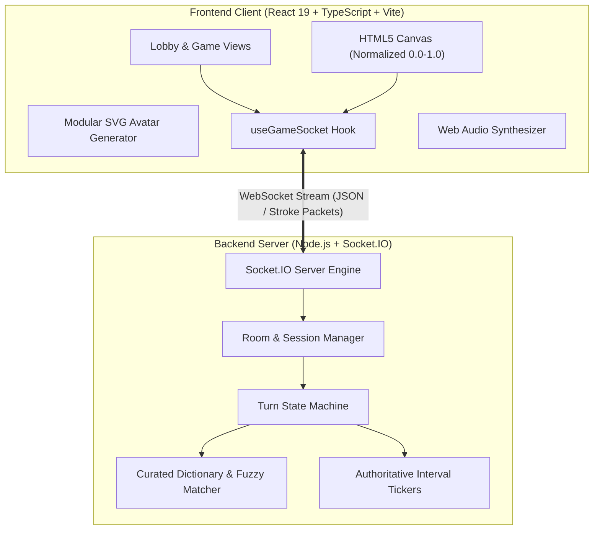

# 🎨 DrawBattle — Real-Time Multiplayer Drawing & Guessing Game

<div align="center">

[](https://draw-battle-multiplayer.vercel.app)
[](https://draw-battle-multiplayer.vercel.app)
[](https://github.com/arpan-jain-2006/DrawBattle-multiplayer)

<br/>

**A fast-paced, full-stack multiplayer drawing and guessing battle arena built with React 19, TypeScript, HTML5 Canvas, Node.js, and Socket.IO.**

[🎮 Play Live Demo](https://draw-battle-multiplayer.vercel.app) • [📦 GitHub Repository](https://github.com/arpan-jain-2006/DrawBattle-multiplayer) • [📖 Documentation](#-table-of-contents)

</div>

---

## 🔗 Live Application Link

| Service | Platform | Live URL | Status |
| :--- | :--- | :--- | :--- |
| **🎮 Live Game App** | **Vercel** | **[https://draw-battle-multiplayer.vercel.app](https://draw-battle-multiplayer.vercel.app)** | ✅ Live |
| **📦 GitHub Repository** | **GitHub** | **[arpan-jain-2006/DrawBattle-multiplayer](https://github.com/arpan-jain-2006/DrawBattle-multiplayer)** | ✅ Public |

---

## 📑 Table of Contents

- [Live Application Link](#-live-application-link)
- [Project Overview](#-project-overview)
- [Key Features](#-key-features)
- [Tech Stack](#-tech-stack)
- [System Architecture](#-system-architecture)
- [WebSocket API Reference](#-websocket-api-reference)
- [Local Setup & Installation](#-local-setup--installation)
- [Environment Variables](#-environment-variables)
- [How to Play](#-how-to-play)
- [Author & License](#-author--license)

---

## 💡 Project Overview

**DrawBattle** is a full-featured real-time multiplayer drawing and guessing game inspired by Skribbl.io. Players take turns sketching secret words on a shared vector canvas while other participants race against the clock to guess the drawing in live chat. 

The application is engineered with a **server-authoritative state machine**, **normalized vector coordinate streaming**, **anti-spoiler chat protection**, and a **100% responsive dark-mode game arena** optimized for both laptops/desktops and mobile smartphones.

---

## 🌟 Key Features

### 🎨 1. Real-Time HTML5 Vector Canvas
- **Normalized Vector Coordinates (0.0 to 1.0)**: Coordinates are streamed as ratios rather than fixed pixels, guaranteeing pixel-perfect stroke synchronization regardless of device resolution, window scaling, or mobile screen sizes.
- **Quadratic Bezier Curve Interpolation**: Smooths stroke points on the fly to eliminate jagged lines at 60 FPS.
- **Artist Toolkit**:
  - ✏️ Pen tool with 4 thickness levels (`Small`, `Medium`, `Large`, `Extra Large`).
  - 🎨 Curated 22-color vibrant palette arranged in an accessible grid.
  - 🧹 Eraser tool.
  - ↩️ Instant Undo action stack.
  - 🗑️ Clear Canvas buffer.
- **Touch & Mobile Drawing**: Full pointer event handling with `touchAction: none` to prevent unintended page scroll or pull-to-refresh while drawing on phones.

### 📱 2. 100% Responsive Game Arena (Mobile & Desktop)
- **Desktop Layout**: Balanced 3-column view featuring the Live Player Leaderboard (left), Drawing Canvas & Toolbar (center), and Real-time Guessing Chat (right).
- **Mobile Layout (Phones & Tablets)**:
  - Sticky top-locked Canvas keeps the active drawing in view at all times.
  - Dedicated **Mobile Tabs Switcher** (`[💬 Chat & Guess]` and `[👥 Players]`) to seamlessly toggle between chat and leaderboard without clutter.
  - 2-tier header preventing text collisions between word blanks, timer, and room buttons.

### 💬 3. Smart Guessing & Anti-Spoiler Chat
- **Instant Answer Matching**: Server validates guesses case-insensitively with instant score calculation.
- **Anti-Spoiler Isolation**: When a player guesses the word correctly, their chat message transforms into a celebratory green announcement (`[Player] guessed the word! 🎉`). Subsequent messages from winning players are hidden from players who are still guessing, preventing spoilers.
- **Fuzzy Typo Detection**: Levenshtein distance algorithm sends a private *"You are close!"* hint if a guess is off by 1–2 letters.
- **Dynamic Speed Bonus Scoring**:
  $$\text{Points} = \max\left(100, \text{round}\left(100 + 400 \times \frac{t_{\text{remaining}}}{t_{\text{total}}}\right) + \text{RankBonus}\right)$$
  The drawer also receives bonus points for every player who correctly identifies their sketch.

### 🏠 4. Lobby & Private Room Management
- **Custom Room Codes**: 6-character unique room identifiers with instant invite link generation (`https://draw-battle-multiplayer.vercel.app?room=CODE`).
- **Host Privileges**: Room creator can configure:
  - Players limit (2 – 20 players)
  - Number of rounds (2 – 10 rounds)
  - Turn draw time (20 – 180 seconds)
  - Progressive letter hints (0 – 5 hints)
  - Custom words list (via comma-separated entries)
- **Live Player Roster**: Avatar previews, ready/unready toggles, and host crown indicator.

### 🎭 5. Modular SVG Avatar Customizer
- Built-in avatar generator allowing players to choose custom colors, expressions, and accessories before joining games.

### 🏆 6. Turn Lifecycle & 3-Step Champion Podium
- **Word Selection Stage**: Drawer chooses from 3 randomized words with a 15-second countdown.
- **Dynamic Letter Hint Reveals**: Timed letter unmasking (e.g. `_ _ _ _ _` $\to$ `_ A _ _ _` $\to$ `_ A _ E _`).
- **Round Summary**: Intermission modal showing the revealed word and points gained by each player.
- **Podium Ceremony**: 1st, 2nd, and 3rd place animated podium with celebratory confetti cannons and a "Play Again" instant room reset.

### 🔊 7. Synthesized Web Audio Sound Effects
- Custom Web Audio API synthesizer generates pop clicks, guess chimes, countdown ticks, and victory fanfares without external audio asset downloads.

---

## 🛠️ Tech Stack

### Frontend
| Technology | Description |
| :--- | :--- |
| **React 19** | Component-based UI framework |
| **TypeScript** | Type-safe enterprise codebase |
| **Vite** | Ultra-fast build tool and dev server |
| **Socket.IO Client** | Real-time bi-directional WebSocket client |
| **HTML5 Canvas API** | High-performance 2D vector rendering |
| **Lucide React** | Clean, modern iconography |
| **Canvas-Confetti** | Particle celebratory effects on podium |
| **Vanilla CSS** | Custom design system with CSS tokens & glassmorphic dark theme |

### Backend
| Technology | Description |
| :--- | :--- |
| **Node.js** | Server runtime environment |
| **Express** | HTTP web framework for health endpoints and CORS |
| **Socket.IO** | Real-time WebSocket server engine with room isolation |
| **TypeScript** | Strict compile-time checks |
| **Levenshtein Distance** | Fuzzy spell-checking algorithm |

---

## 🏛️ System Architecture



---

## 🔌 WebSocket API Reference

### Room & Lobby Events
| Event | Direction | Payload | Description |
| :--- | :--- | :--- | :--- |
| `room:create` | Client $\to$ Server | `{ player, settings }` | Creates a new private room |
| `room:join` | Client $\to$ Server | `{ roomId, player }` | Joins existing room; synchronizes state & stroke history |
| `room:state` | Server $\to$ Client | `RoomState` | Full state broadcast on player join, leave, or ready toggle |
| `room:update_settings` | Client $\to$ Server | `Partial<RoomSettings>` | Host updates rounds, draw time, or hints |
| `room:ready` | Client $\to$ Server | `boolean` | Toggles player ready state |
| `game:start` | Client $\to$ Server | `void` | Host launches the match |

### Real-Time Drawing Events
| Event | Direction | Payload | Description |
| :--- | :--- | :--- | :--- |
| `draw:stroke` | Client $\leftrightarrow$ Server | `StrokeCommand` | Emits normalized vector stroke points array |
| `draw:clear` | Client $\leftrightarrow$ Server | `void` | Wipes current canvas buffer |
| `draw:undo` | Client $\leftrightarrow$ Server | `void` | Removes the most recent stroke from history |

### Gameplay & Chat Events
| Event | Direction | Payload | Description |
| :--- | :--- | :--- | :--- |
| `game:word_selection` | Server $\to$ Client | `{ choices, timeout, isDrawer }` | Sends 3 word choices to current drawer |
| `game:choose_word` | Client $\to$ Server | `{ word }` | Drawer selects their target word |
| `game:timer_tick` | Server $\to$ Client | `{ secondsRemaining }` | Authoritative 1-second countdown tick |
| `game:hint_reveal` | Server $\to$ Client | `{ maskedWord }` | Reveals unmasked hint letters to guessers |
| `chat:send` | Client $\to$ Server | `{ text }` | Submits a guess or chat message |
| `chat:message` | Server $\to$ Client | `ChatMessage` | Broadcasts chat message or correct guess badge |
| `game:round_end` | Server $\to$ Client | `{ word, roundScores, reason }` | Concludes round and reveals points |
| `game:game_over` | Server $\to$ Client | `{ leaderboard, winner }` | Displays final scores and 3-step podium |
| `game:reset` | Client $\to$ Server | `void` | Resets game back to lobby |

---

## 💻 Local Setup & Installation

Follow these steps to run DrawBattle on your local machine:

### 1. Prerequisites
- **Node.js**: v18.0.0 or higher
- **npm**: v9.0.0 or higher
- **Git**

### 2. Clone the Repository
```bash
git clone https://github.com/arpan-jain-2006/DrawBattle-multiplayer.git
cd DrawBattle-multiplayer
```

### 3. Install Dependencies
```bash
# Install root, backend, and frontend dependencies
npm install
npm --prefix backend install
npm --prefix frontend install
```

### 4. Configure Environment Variables

**Backend (`backend/.env`):**
```env
PORT=3001
FRONTEND_URL=http://localhost:5173
```

**Frontend (`frontend/.env`):**
```env
VITE_BACKEND_URL=http://localhost:3001
```

### 5. Run in Development Mode
Run both backend and frontend concurrently with a single command:
```bash
npm run dev
```

- **Frontend Application**: [http://localhost:5173](http://localhost:5173)
- **Backend Health Check**: [http://localhost:3001/api/health](http://localhost:3001/api/health)

---

## ⚙️ Environment Variables

### Backend Configuration
| Variable | Description | Example |
| :--- | :--- | :--- |
| `PORT` | Port number for Express & Socket.IO server | `3001` |
| `FRONTEND_URL` | Allowed CORS origin for frontend requests | `http://localhost:5173` |

### Frontend Configuration
| Variable | Description | Example |
| :--- | :--- | :--- |
| `VITE_BACKEND_URL` | WebSocket & HTTP URL of backend server | `http://localhost:3001` |

---

## 🎮 How to Play

1. **Join or Create a Room**: Enter your nickname, customize your avatar, and click **Create Private Room** (or enter a 6-character code to join a friend).
2. **Invite Friends**: Copy the room link (`?room=CODE`) and share it with friends (minimum 2 players required).
3. **Take Turns Drawing**: When it's your turn, pick 1 of 3 words and sketch it on the canvas using colors, brush sizes, and tools before time runs out.
4. **Guess & Score**: When another player is drawing, type your guesses into the chat. The faster you guess correctly, the more points you earn!
5. **Win the Game**: After all rounds conclude, the player with the highest total points takes the top spot on the podium!

---

## 👤 Author & Acknowledgments

- **Author**: Arpan Jain ([@arpan-jain-2006](https://github.com/arpan-jain-2006))
- **Live Game App**: [https://draw-battle-multiplayer.vercel.app](https://draw-battle-multiplayer.vercel.app)
- **License**: [MIT License](LICENSE) — Feel free to use, fork, and contribute!
