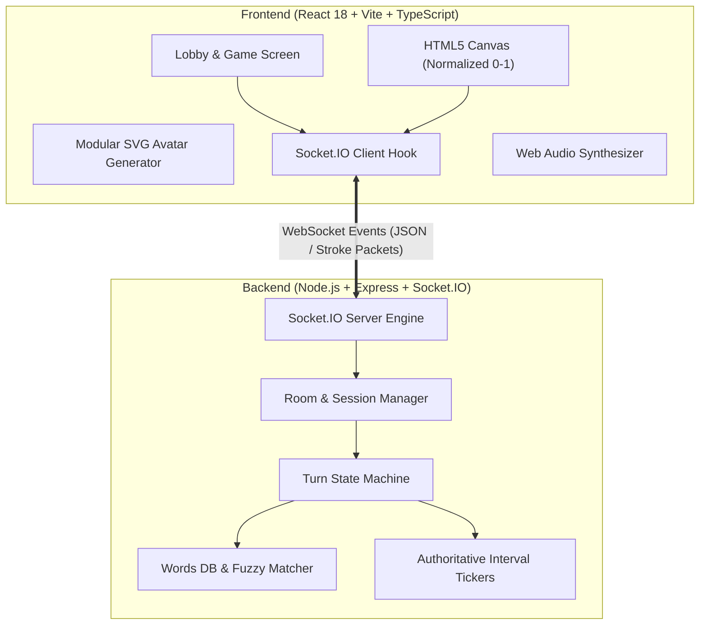

# 🎨 Skribbl.io Full-Stack Clone — Multiplayer Drawing & Guessing Game

A modern, high-performance, real-time multiplayer drawing and guessing game built with **React, TypeScript, HTML5 Canvas, Node.js, Express, and Socket.IO**.

---

## 🌟 Key Features

### 🏠 1. Room & Lobby System
- **Create Private Rooms**: Customizable game settings:
  - Players: 2 – 20
  - Rounds: 2 – 10
  - Draw time: 20 – 180 seconds
  - Hints: 0 – 5 (or disabled)
  - Custom words: Add custom vocabulary lists via comma separation
- **One-Click Shareable Invite Links**: Format `?room=ROOM_CODE` auto-populates code on arrival.
- **Interactive Lobby**: Live player roster, customizable SVG avatars, host crown, and player ready states.
- **Host Privileges**: Only the room host can adjust settings and initiate match launch once $\ge 2$ players join.

### 🎨 2. Real-Time HTML5 Canvas Drawing
- **Normalized Vector Sync**: Coordinates are normalized $(0.0 \to 1.0)$, guaranteeing identical stroke rendering across screens, mobile devices, and window resizes.
- **Fluid Bezier Curves**: Real-time quadratic bezier curve interpolation prevents jagged lines.
- **Artist Tools**:
  - ✏️ Pen / Brush with 4 thickness levels (Small, Medium, Large, Extra Large)
  - 🎨 Curated 22-Color High-Contrast Palette
  - 🧹 Eraser tool
  - ↩️ Instant Undo stack
  - 🗑️ Clear Canvas buffer
- **Spectator & Reconnect Replay**: Rejoining players receive full `strokeHistory` instantly.

### 💬 3. Smart Guessing & Anti-Spoil Chat
- **Instant Answer Matching**: Server checks guess case-insensitively with instant score award.
- **Anti-Spoil Isolation**: When a player guesses correctly, their message turns into a congratulatory green announcement. Subsequent messages from that player are hidden from active guessers, preventing spoilers.
- **Fuzzy Spell Check**: Levenshtein distance check triggers private *"You are close!"* prompt for minor typos.
- **Time-Decay Dynamic Scoring**:
  $$\text{Points} = \max\left(100, \text{round}\left(100 + 400 \times \frac{t_{\text{remaining}}}{t_{\text{total}}}\right) + \text{RankBonus}\right)$$
  Drawer also receives bonus score for each player who guesses correctly.

### ⏱️ 4. Server-Authoritative Timer & Dynamic Hints
- Server manages authoritative `setInterval` tick down, preventing client clock tampering.
- Gradual letter unmasking schedule (e.g. `_ _ _ _ _` $\to$ `_ A _ _ _` $\to$ `_ A _ E _`) based on hint configuration.

### 🏆 5. Leaderboard, Intermission & Podium
- Live in-game sidebar leaderboard showing real-time scores, avatars, and active drawer indicators.
- 5-second round end intermission displaying secret word and score gains.
- End-of-game 3-step podium (1st, 2nd, 3rd) with celebratory confetti particles and "Play Again" room reset.

### 🔊 6. Synthesized Web Audio Effects
- Web Audio API synthesizer generates pleasant pop clicks, dual-tone guess chimes, timer ticks, and victory fanfares without external audio file loading failures.

---

## 🏛️ System Architecture



---

## 🔌 WebSocket Events Reference

### Room & Lobby Events
| Event | Direction | Payload | Description |
| :--- | :--- | :--- | :--- |
| `room:create` | Client $\to$ Server | `{ player, settings }` | Creates room with unique 6-character code |
| `room:join` | Client $\to$ Server | `{ roomId, player }` | Joins room, returns room state & stroke history |
| `room:state` | Server $\to$ Client | `RoomState` | Full state sync on player join, leave, or update |
| `room:update_settings` | Client $\to$ Server | `Partial<RoomSettings>` | Host updates rounds, draw time, or hints |
| `room:ready` | Client $\to$ Server | `boolean` | Toggles player ready status |
| `game:start` | Client $\to$ Server | `void` | Host initiates the match |

### Drawing Stream Events
| Event | Direction | Payload | Description |
| :--- | :--- | :--- | :--- |
| `draw:stroke` | Client $\leftrightarrow$ Server | `StrokeCommand` | Sends normalized vector points array |
| `draw:clear` | Client $\leftrightarrow$ Server | `void` | Wipes canvas stroke history |
| `draw:undo` | Client $\leftrightarrow$ Server | `void` | Pops last stroke from history |

### Chat & Gameplay Events
| Event | Direction | Payload | Description |
| :--- | :--- | :--- | :--- |
| `game:word_selection` | Server $\to$ Client | `{ choices, timeout, isDrawer }` | 3 word options sent to drawer |
| `game:choose_word` | Client $\to$ Server | `{ word }` | Drawer selects their chosen word |
| `game:timer_tick` | Server $\to$ Client | `{ secondsRemaining }` | Authoritative 1-second interval |
| `game:hint_reveal` | Server $\to$ Client | `{ maskedWord }` | Reveals unmasked hint letters |
| `chat:send` | Client $\to$ Server | `{ text }` | Submits guess or chat message |
| `chat:message` | Server $\to$ Client | `ChatMessage` | Broadcasts message or correct guess banner |
| `game:round_end` | Server $\to$ Client | `{ word, roundScores, reason }` | Reveals round results |
| `game:game_over` | Server $\to$ Client | `{ leaderboard, winner }` | Concludes match; launches podium |
| `game:reset` | Client $\to$ Server | `void` | Resets match back to lobby |

---

## 💻 Code Walkthrough & Technical Details

### 1. How Drawing Strokes Are Captured & Transmitted
- In `frontend/src/components/Canvas/DrawingCanvas.tsx`, `onMouseDown` and `onTouchStart` register initial normalized coordinates $(x / \text{width}, y / \text{height})$.
- As the artist moves their cursor/finger, points are gathered and rendered locally with zero latency.
- Upon stroke completion (`onMouseUp` / `onTouchEnd`), a `StrokeCommand` containing the tool (`pen` / `eraser`), color, brush size, and normalized points array is emitted via `draw:stroke`.
- Other clients receive the stroke and render it through quadratic bezier curve smoothing.

### 2. How Game State Is Maintained
- The server (`backend/src/models/Room.ts`) is the single source of truth.
- A finite state machine controls the game flow:
  $$\text{LOBBY} \longrightarrow \text{WORD\_SELECTION} \longrightarrow \text{DRAWING} \longrightarrow \text{ROUND\_END} \longrightarrow \text{GAME\_OVER}$$
- Client disconnects, host migration, and turn skipping are handled gracefully without desync.

### 3. Turn Rotation & Scoring Calculation
- When a game starts, player IDs are randomly shuffled into `drawerOrder`.
- For each round, players take turns as drawer until everyone has drawn once.
- Points awarded reward quick answers:
  $$\text{GuesserPoints} = \text{round}\left(100 + 400 \times \frac{t_{\text{remaining}}}{t_{\text{total}}}\right) + \text{bonus}$$
- The drawer also receives bonus points whenever guessers successfully guess their drawing.

---

## 🚀 Getting Started

### Prerequisites
- Node.js (v18.x, v20.x, or v22.x)
- npm (v9.x or v10.x)

### 1. Clone & Install Dependencies
```bash
# Clone the repository
git clone <repository-url>
cd web3asssingment

# Install all dependencies (root, backend, frontend)
npm install
npm --prefix backend install
npm --prefix frontend install
```

### 2. Run Locally in Development Mode
To launch both the backend server (port 3001) and frontend client (port 5173) simultaneously:
```bash
npm run dev
```

- **Frontend**: [http://localhost:5173](http://localhost:5173)
- **Backend API**: [http://localhost:3001/api/health](http://localhost:3001/api/health)

### 3. Production Build
```bash
npm run build
```

---

## 🌐 Deployment Guide

### Deploying Backend (Render / Railway / Fly.io)
1. Set Environment Variables:
   - `PORT`: `3001` (or provider assigned)
2. Build Command: `npm install && npm run build`
3. Start Command: `npm run start`

### Deploying Frontend (Vercel / Netlify)
1. Root Directory: `frontend`
2. Build Command: `npm run build`
3. Output Directory: `dist`
4. Set Environment Variable:
   - `VITE_BACKEND_URL`: URL of your deployed backend (e.g. `https://your-skribbl-backend.onrender.com`)

---

## 📄 License
MIT License. Built for full-stack assignment demonstration.
